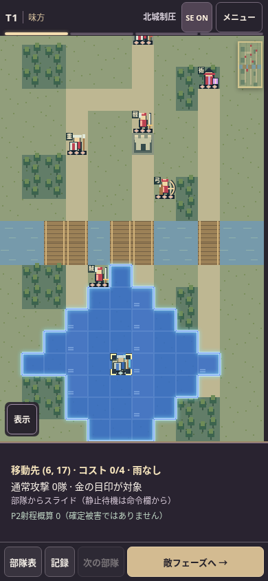
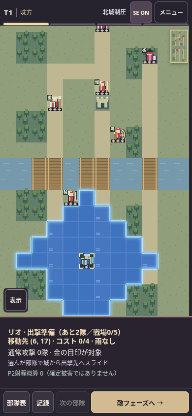
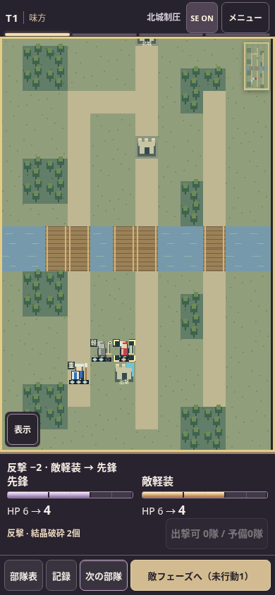
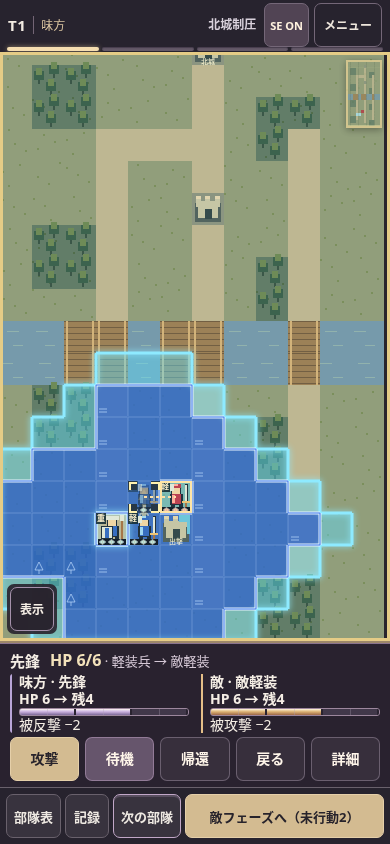
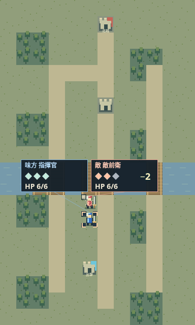

# スマホ縦持ち・実プレイ監査（2026-11-16）

## 実装前の技術設計

制作者の本依頼を根拠に、レビュー用PRまで行う。**マージ保留**。Issue起票・既存Issueコメント・承認・マージ・自動マージ・Settings/workflows変更は行わない。最新AGENTSの自動操縦規程より今回の明示制約を優先する。

主経路は本編1章の城→控え→出撃→味方選択→移動待機→敵へのスライド→予測→攻撃/反撃→盤面復帰。390×844を代表、360/430幅と短い縦画面、別マップの端・混雑も確認する。

現段階でコードと採用仕様が異なる候補:

- AGENTS invariant9/今回依頼は敵へのスライド後に予測で攻撃を一度選ぶ。一方app.jsはenemy releaseでcommit('attack')し、説明も「直接攻撃」。過去テストの期待も即攻撃。この不一致は現在の明示操作に合わせ、解放ではドラフトの予測だけを開く。Attackクリックのatomic保存・engine命令は既存共通処理を維持する。
- playbackは反撃開始時に拡大HPの参加者を攻撃役順で作り直すため、隣接縦配置でHP板が入れ替わる。参加者の順序を一戦中保持し、被弾対象のみ更新する。ルールや着弾順・採用済み半片演出・速度設定は変更しない。

上記を実タッチの基準再現で確認後に修正する。その他の問題は観察の根拠と再現を伴う範囲で追加。app/ui-input/CSSは入力状態・予測・導線、playback/renderは表示専用とし、engine/config/data/saveは変更しない。HP6・4フェーズ・出撃・永続ロスト・保存互換・音楽設定を維持。

検証は既存checkと全test:browserを実行し、具体的な見逃し（releaseの誤確定、板の帰属、表示HP復帰）へ必要な回帰を追加。iPhone実機、実指・実耳、人による遊び心地の評価とは区別する。数値/地形/ルールは変更しないためsimulate/audit:balanceは変更検証の対象外（必要な場合は範囲と結果を追記）。

## 再現・修正・確認

|優先|プレイヤーの目的／再現|変更前と原因|今回の修正と確認|
|---|---|---|---|
|1|味方→合法な射撃地点→敵へ滑らせて離す。予測を読んで選びたい|enemy releaseで直接commit。指を離しただけでHP/行動回数/保存が変わる。古いフリック検査も即攻撃を期待していた|解放は予測だけ。Attack一回で既存commit。解放/予測を閉じる時点の完全state不変、二重クリックでも命令1回、狙った敵と経路維持を検査|
|2|縦隣接の味方が攻撃し、敵が反撃。減ったHPを目で追いたい|反撃のwindupが[actor,target]を作り直し、左右同座標のHP板が反転|一戦の参加者順を保持しHPだけ更新。味方先制/敵先制で板のID・矩形を維持。実際のP2でも被弾側・結果を確認|
|2|全景で双方の初期HP→着弾→反撃を読む|拡大HPの文字もマップ倍率に追従し、map01の30〜35pxマスで約6.6〜7.7CSSpx。広いmap02ではさらに小さくなる|板132×64CSSpx、名前12/HP14/ダメージ18CSSpxを基準に配置。宝石と破片は専用行、数値と分離。360/390/430幅・短い縦・広いmap02で確認|
|2|予告付き・画面上端の戦闘でHPを読む|HP板の可視領域が予告バナーを除外しない。390幅の再現で板y54〜118に対しバナーy52〜96、ミニマップも重なる|HP用領域だけ予告高を除く。拡大HP中のみミニマップ/地図ボタンをvisibilityで退避し、終了後に復帰。盤面とカメラは動かさない|
|3|城→控え選択後、誰をどこへ出すか確かめる|控えを選ぶと名前/残枠が消え、命令欄が汎用の経路ヒントになる|ヒントに選択名・出撃準備・残出撃数/盤上上限を保持。主経路で選択から出撃まで確認|
|3|予測で両者の現在HP/残HPと反撃を読む|味方名は見出し、敵名は見出し末尾に寄り、狭い画面で省略される|各列に「味方/敵＋名前」「HP現在→残」「被反撃/被攻撃」を表示。固定144pxドック内に収め、子要素の切れを4寸法で検査|

盤面の行動済みは既存の灰色＋印を保持。占有された城の最初のタップは部隊選択、選択済みで城を再タップすると控えを開く既存動作も維持し、別の出撃規則には変えていない。初回の城は空で、通常タップで控えを開ける。

## 画面比較

いずれもゲームのみを撮影したレビュー用静止画。出撃比較は同じ本編1章の選択直後、解放比較は同じ標準性能の短い局所再現（先鋒/敵軽装ともHP6）を使用。公開版の比較も390×844で取得し、基準main `7e14aad` のapp.js等と内容一致を確認した。公開取得は環境のCAを使う証明書検証付きHTTPS経由でブラウザへ中継した。

|場面|変更前|修正後|
|---|---|---|
|控えを選んだ直後|||
|敵の上で指を離した直後|||

攻撃の着弾と反撃の着弾。HP板は味方/敵の同じ並びを保持する。

## 検証範囲と限界

- 起動方法: 静的ESモジュール、ビルド工程なし。`npm run dev` または `python3 -m http.server 4184 --bind 127.0.0.1`。既存4173が応答不良となった再開後はTEST_URLで4184を指定した。
- Node24.22.1 / Playwright1.57.0 / bundled Chromium143。基準公開画面・基準再現はsystem Chromium156でも取得。全景の主経路は390×844、同じ目的を360×740/430×932/390×568でも自動確認。既存スイートは320幅と844×390横も対象。
- `npm run check`（基準198件）と `TEST_URL=http://127.0.0.1:4184 PLAYWRIGHT_BROWSERS_PATH=/tmp/srpg-pw-browsers npm run test:browser`。最終SHAと終了結果はPR本文に記録する。
- 新規 `mobile-play-browser` は本編1章を通常の城タップ/控え/出撃2回→P2→T2→空きマスの移動待機→予測/取消/攻撃/反撃→再開まで通す。390幅の短画面・map04端の混雑でpointercancel/2本指/二重攻撃、P2敵攻撃→P3砲撃/回復→P4予告→次P1も確認する。
- 新規 `combat-hp-browser` は各寸法でHP6→5/3→2/2→0、攻撃反撃生存、反撃なし、反撃で味方離脱、map04端、広いmap02、予告付き上端、P2敵先制の10状況、計40ケース。無音で初期/着弾/反撃の帰属、板位置/見切れ、最終engine結果・保存/再読込・盤面HP・カメラ・ナビ復帰を検査。既存の半片/撃破・3画風検査も維持。
- 既存のフリック等の検査は即攻撃期待を「解放ではstate不変→Attack→同一engine最終値」に更新した。最終値・命令回数・cancel・保存の検査を削っていない。
- エンジン・数値・地形・保存形式は不変。simulate/audit:balanceは実行対象外。表示のために戦闘結果の確定順やフェーズ順を変更していない。入力の確定契機だけ依頼どおりAttackボタンに揃えた。
- 独立担当が初期差分をレビューし、HP継続の単体検査・4寸法DOM検査を実行。発見した予測の1.5px見切れを修正・再確認。最終の予告重なり対策/検査追補までの独立再レビューは利用枠終了のため未実施で、最終確認は実装者による。iPhone/Safari実機、実際の指、実耳、人間の遊び心地評価は未実施。

## iPhoneで短く試す3件

1. 本編1章で城→リオをタップ。命令欄に「リオ・出撃準備」と残枠が見え、城から空きマスへ滑らせると一度だけ出撃、次の控えを選べれば成功。
2. 味方から合法な攻撃位置を経て敵へ滑らせる。離してもHPは減らず、味方/敵の予測が残る。「戻る」で行動を消費せず盤面へ戻り、再度選んで「攻撃」で一度だけ実行できれば成功。
3. 反撃のある攻撃をSE OFFで実行。双方の名前とHPの並びが変わらず、一撃ごとの被弾が読め、終了後に小HPとミニマップが戻り、次の味方を選べれば成功。画面端や予告付きでもHPが切れないか併せて見る。
